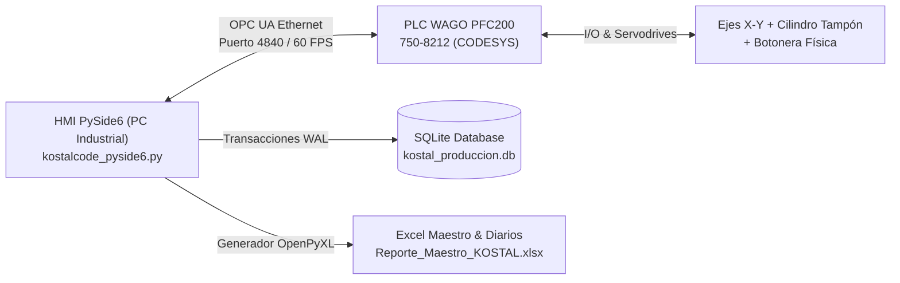
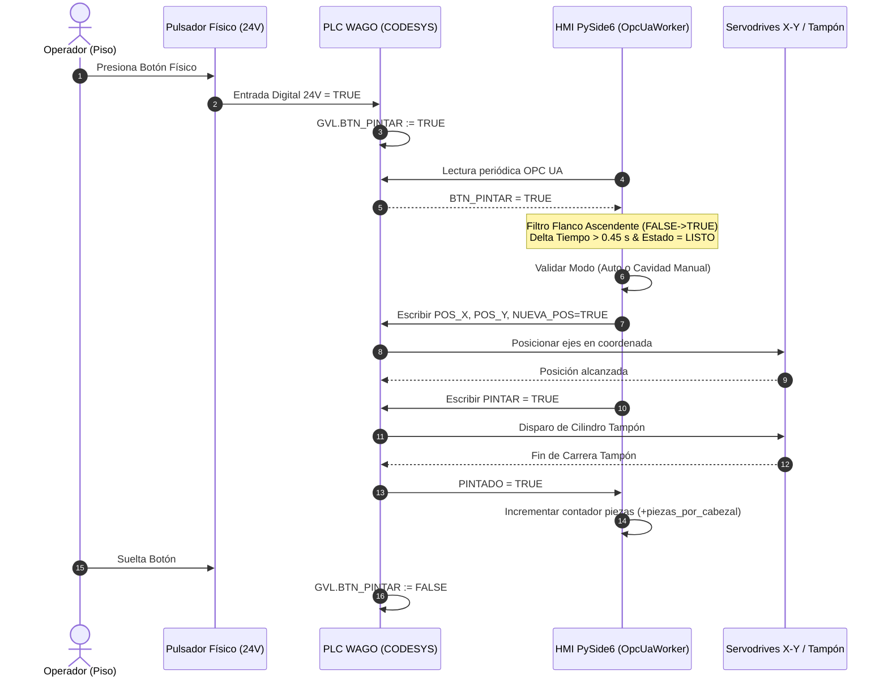

# KOSTAL MEXICANA — MANUAL TÉCNICO Y OPERATIVO DE SISTEMA HMI/PLC
## ESTACIÓN AUTOMATIZADA DE TAMPOGRAFÍA INDUSTRIAL (EST-KOSTAL-04)
### Control Numérico de Ejes X-Y, Comunicaciones OPC UA y Gestión de Producción

---

```
========================================================================================
                      KOSTAL MEXICANA S.A. DE C.V.
              DEPARTAMENTO DE INGENIERÍA DE MANUFACTURA Y AUTOMATIZACIÓN
----------------------------------------------------------------------------------------
Documento No.   : MAN-EST-KOSTAL04-2026-V2.0
Estación        : EST-KOSTAL-04 (Tampografía Bipolar Ejes X-Y)
Plataforma HMI  : PySide6 (Qt 6.6+ / Aceleración Gráfica Hardware 60 FPS)
Controlador     : PLC WAGO PFC200 (750-8212) CODESYS v3.5
Protocolo Red   : OPC UA Industrial (IEC 62541)
Versión Software: 2.0.4-LTS Industrial Release
Fecha de Emisión: Noviembre 2026
Clasificación   : Documento Técnico Operativo y de Mantenimiento / Uso Interno
========================================================================================
```

---

## ÍNDICE GENERAL

1. [Portada y Control de Documento](#portada-y-control-de-documento)
2. [Introducción y Objetivos](#1-introducción-y-objetivos)
   - 1.1 Propósito del Documento
   - 1.2 Alcance del Sistema
   - 1.3 Filosofía de Operación y Seguridad Industrial (Normativa ISO 13849-1)
3. [Arquitectura de Hardware y Comunicaciones](#2-arquitectura-de-hardware-y-comunicaciones)
   - 2.1 Topología de Red y Conectividad PLC WAGO
   - 2.2 Especificación del Bus OPC UA (Namespace, Nodos y Tipos de Datos)
   - 2.3 Diccionario Integral de Variables PLC (Lectura, Escritura y Diagnóstico)
   - 2.4 Integración de Botón Físico de Inicio de Ciclo (`BTN_PINTAR`)
4. [Manual de Operación — Perfil Operador](#3-manual-de-operación--perfil-operador)
   - 3.1 Procedimiento de Encendido y Puesta en Marcha
   - 3.2 Inicio de Sesión Táctil
   - 3.3 Interfaz de Operación Simplificada
   - 3.4 Selección y Carga de Jigs / Recetas (Menú Táctil Ampliado)
   - 3.5 Modos de Operación: Modo Automático vs. Modo Manual
   - 3.6 Plegado y Desplegado de Mandos de Control con Escalado Dinámico de Cruceta
   - 3.7 Operación en Modo Manual: Selección de Cavidad en Matriz y Continuidad de Ciclo
   - 3.8 Arranque de Ciclo mediante Botón Físico de Máquina
   - 3.9 Protocolo de Seguridad ante Paro de Emergencia (Secuencia Obligatoria PARO -> RESET -> INICIO)
   - 3.10 Registro de Fin de Hora / Corte Horario y Reinicio Automático de Contadores
5. [Manual de Ingeniería y Configuración — Perfil Administrador](#4-manual-de-ingeniería-y-configuración--perfil-administrador)
   - 4.1 Ingreso al Entorno de Ingeniería y Permisos Restringidos
   - 4.2 Módulo 1: Recetario Maestro de Producción
     - 4.2.1 Creación y Edición de Recetas de Jig
     - 4.2.2 Dimensionamiento de Matrices (Filas x Columnas)
     - 4.2.3 Desacoplamiento de Cabezal Múltiple (`piezas_por_cabezal`) y Capacidad Real
     - 4.2.4 Calibración de Punto Cero (Set 0 por Posición Actual o Coordenadas Teóricas)
     - 4.2.5 Duplicación Rápida de Recetas Mediante Menú Contextual de Tres Puntos (`⋮`)
   - 4.3 Módulo 2: Estadísticas, Trazabilidad y Reportes
     - 4.3.1 Registro General Histórico de Producción (Exclusivo Administradores)
     - 4.3.2 Tabla de Producción por Empleado (Métricas Totales, OK, NOK y % Scrap)
     - 4.3.3 Historial Horario de Turno
     - 4.3.4 Motor de Base de Datos SQLite WAL y Respaldo Concurrente
     - 4.3.5 Generación Automatizada de Reportes Corporativos en Excel (`.xlsx`) y CSV
   - 4.4 Módulo 3: Control de Usuarios y Seguridad de Acceso
     - 4.4.1 Interlock de Cuota Mínima Obligatoria (Mínimo 1 Admin y 1 Operador)
     - 4.4.2 Creación, Modificación de Contraseña y Asignación de Roles
   - 4.5 Módulo 4: Parámetros Globales de Conexión y PLC
     - 4.5.1 Direccionamiento IP, Puertos y Tiempos de Ciclo OPC UA
     - 4.5.2 Cinemática de Ejes X/Y (Límites Físicos, Velocidades y Rampas)
6. [Diagnóstico de Fallas, Mantenimiento y Resolución de Problemas](#5-diagnóstico-de-fallas-mantenimiento-y-resolución-de-problemas)
   - 5.1 Matriz de Alarmas y Códigos de Error
   - 5.2 Pérdida de Enlace OPC UA y Reconexión en Caliente
   - 5.3 Mantenimiento de Bases de Datos y Limpieza de Archivos Temporales
   - 5.4 Procedimiento de Arranque en Caso de Corte Eléctrico Inesperado
7. [Fichas Técnicas y Apéndices](#6-fichas-técnicas-y-apéndices)
   - 7.1 Resumen de Comandos de Ejecución
   - 7.2 Estructura de Directorios del Sistema

---

## 1. INTRODUCCIÓN Y OBJETIVOS

### 1.1 Propósito del Documento
El presente documento constituye la especificación técnica integral, manual de usuario y guía de mantenimiento para la interfaz hombre-máquina (HMI) desarrollada para la **Estación de Tampografía Industrial EST-KOSTAL-04** en la planta de KOSTAL Mexicana.

Este sistema controla el posicionamiento micrométrico biaxial (ejes X e Y), el accionamiento del tintero/tampón neumático y la gestión de trazabilidad de lotes automotrices.

### 1.2 Alcance del Sistema
La plataforma de software `kostalcode_pyside6.py` gobierna integralmente:
1. **Cinemática de Ejes:** Control de coordenadas X (0.0 a 88.0 mm) e Y (0.0 a 200.0 mm) con resolución de $0.01\text{ mm}$ (10 micras), gestionando factores de conversión a centésimas de milímetro enteras (`INT32`) requeridas por el PLC WAGO.
2. **Ciclo de Impresión:** Secuenciamiento coordinado de movimiento a cavidad, bajada de tampón, tiempo de asentamiento de tinta, retracción y confirmación de pintado.
3. **Cabezal Múltiple Dinámico:** Cálculo automático del total de piezas producidas por golpe según el cabezal instalado ($1, 2, 3$ o más piezas simultáneas).
4. **Trazabilidad y Calidad:** Registro relacional en SQLite (modo Write-Ahead Logging) y exportación simultánea a hojas corporativas de Microsoft Excel (`.xlsx`) y archivos de texto plano CSV.
5. **Seguridad y Jerarquías:** Segmentación de perfiles (Operador vs. Administrador) con interlocks de seguridad que impiden maniobras no autorizadas en piso de producción.



### 1.3 Filosofía de Operación y Seguridad Industrial
El sistema está diseñado bajo el principio de **Cero Defectos** y **Fail-Safe**:
- **Interlock de Seguridad:** Toda parada de emergencia o paro manual bloquea cualquier acción mecánica. El reinicio de la estación requiere la secuencia física y de software estricta: `PARO -> RESET -> INICIO`.
- **Integridad de Proceso:** El sistema no permite el inicio de ciclo si el PLC reporta alarmas en servodrives, si las cotas exceden los límites mecánicos, o si no se ha seleccionado una receta válida.

---

## 2. ARQUITECTURA DE HARDWARE Y COMUNICACIONES

### 2.1 Topología de Red y Conectividad PLC WAGO
La estación EST-KOSTAL-04 utiliza una arquitectura basada en Ethernet TCP/IP con protocolo de aplicación **OPC UA (IEC 62541)**:
- **Dispositivo Maestro:** PLC WAGO PFC200 (Modelo 750-8212).
- **Dirección IP PLC:** `192.168.1.69`
- **Puerto OPC UA PLC:** `4840`
- **Dirección Servidor Local HMI:** `0.0.0.0` (Puerto `4840`, Endpoint: `opc.tcp://localhost:4840`)
- **Namespace CODESYS:** `4` (`urn:WAGO:CoDeSys:OPCUA`)
- **Prefijo Global de Variables:** `Application.GVL.`

### 2.2 Especificación del Bus OPC UA
El hilo de comunicación `OpcUaWorker` se ejecuta en un `QThread` desacoplado del hilo principal de la interfaz gráfica a una tasa de refresco nominal de $20\text{ a }50\text{ ms}$, garantizando fluidez de 60 FPS en la pantalla táctil sin retrasos por latencia de red.

### 2.3 Diccionario Integral de Variables PLC

| Variable GVL PLC | Tipo de Dato | Dirección | Descripción Funcional |
| :--- | :--- | :--- | :--- |
| `INICIO` | `BOOL` | HMI $\rightarrow$ PLC | Orden de arranque del ciclo de producción automático. |
| `RESET` | `BOOL` | HMI $\rightarrow$ PLC | Señal de restablecimiento de alarmas y rearme de seguridad. |
| `STOP` | `BOOL` | HMI $\rightarrow$ PLC | Parada controlada de ciclo en curso. |
| `PE` | `BOOL` | PLC $\rightarrow$ HMI | Estado del Paro de Emergencia físico (TRUE = Emergencia activa). |
| `MANUAL` | `BOOL` | HMI $\rightarrow$ PLC | Indicador de modo manual activo. |
| `AUTO` | `BOOL` | HMI $\rightarrow$ PLC | Indicador de modo automático activo. |
| `CRUZETA` | `BOOL` | HMI $\rightarrow$ PLC | Habilitación de movimiento por JOG/Cruceta táctil. |
| `NUEVA_POSICION` / `NUEVA_POS` | `BOOL` | HMI $\rightarrow$ PLC | Pulso de confirmación de nuevas coordenadas objetivo cargadas. |
| `POS_X` | `INT32` / `DINT` | HMI $\leftrightarrow$ PLC | Coordenada eje X en centésimas de milímetro ($X_{\text{mm}} \times 100$). Rango: 0 a 8800. |
| `POS_Y` | `INT32` / `DINT` | HMI $\leftrightarrow$ PLC | Coordenada eje Y en centésimas de milímetro ($Y_{\text{mm}} \times 100$). Rango: 0 a 20000. |
| `VELOCIDAD_X` | `INT32` | HMI $\rightarrow$ PLC | Velocidad de traslación eje X en mm/s (por defecto 120 mm/s). |
| `VELOCIDAD_Y` | `INT32` | HMI $\rightarrow$ PLC | Velocidad de traslación eje Y en mm/s (por defecto 120 mm/s). |
| `HOME_X` | `INT32` | HMI $\rightarrow$ PLC | Cota de referencia Cero del eje X en centésimas de mm. |
| `HOME_Y` | `INT32` | HMI $\rightarrow$ PLC | Cota de referencia Cero del eje Y en centésimas de mm. |
| `PINTAR` | `BOOL` | HMI $\rightarrow$ PLC | Comando de disparo para bajada del cilindro de tampografía. |
| `S_TAMPO` | `BOOL` | HMI $\rightarrow$ PLC | Orden de ciclo continuo de tampón. |
| `PINTADO` | `BOOL` | PLC $\rightarrow$ HMI | Confirmación física de que la carrera de tampografía concluyó. |
| `LISTO` | `BOOL` | PLC $\rightarrow$ HMI | Bandera de estación lista para recibir nuevo ciclo. |
| `NO_LISTO` | `BOOL` | PLC $\rightarrow$ HMI | Estación ocupada o bloqueada por condición de proceso. |
| `M_ENE` | `BOOL` | PLC $\rightarrow$ HMI | Servomotores energizados y habilitados. |
| `M_SET` | `BOOL` | PLC $\rightarrow$ HMI | Servomotores referenciados (Home establecido). |
| `ALARM_X` | `BOOL` | PLC $\rightarrow$ HMI | Alarma de fallo en variador/servodrive de eje X. |
| `ALARM_Y` | `BOOL` | PLC $\rightarrow$ HMI | Alarma de fallo en variador/servodrive de eje Y. |
| `SENSOR_X` | `BOOL` | PLC $\rightarrow$ HMI | Sensor de límite o proximidad de eje X. |
| `SENSOR_Y` | `BOOL` | PLC $\rightarrow$ HMI | Sensor de límite o proximidad de eje Y. |
| **`BTN_PINTAR`** | `BOOL` | PLC $\rightarrow$ HMI | **Entrada digital de botón físico de inicio/pintado externo.** |

---

### 2.4 Integración de Botón Físico de Inicio de Ciclo (`BTN_PINTAR`)

Para optimizar la ergonomía y la velocidad de ciclo del operador en línea, la estación cuenta con integración para pulsador industrial físico montado en la estructura del fixture.

#### Especificación Eléctrica y Lógica en PLC (CODESYS)
1. El pulsador físico se conecta a una entrada digital de 24 VDC del PLC WAGO 750-8212 (e.g. módulo de entradas 750-430).
2. En la lista global de variables (`GVL`) del proyecto CODESYS, se mapea la señal hacia la variable:
   ```pascal
   VAR_GLOBAL
       BTN_PINTAR : BOOL := FALSE; (* Pulsador Físico de Ciclo *)
   END_VAR
   ```
3. La interfaz HMI supervisa el valor de `BTN_PINTAR` en cada barrido de comunicación OPC UA.

#### Algoritmo de Detección en HMI
- **Filtro Anti-Rebote:** El software implementa una ventana de supresión de rebote de $450\text{ ms}$ (`_btn_pintar_last_trigger`).
- **Detección de Flanco Ascendente:** El ciclo se dispara únicamente en la transición de `FALSE` a `TRUE` ($0 \rightarrow 1$). Pulsaciones sostenidas no generan ciclos repetitivos accidentales.
- **Interlock Operativo:** Si el sistema está en `PARO`, en estado de alarma de ejes, o ejecutando un ciclo, la señal de `BTN_PINTAR` es ignorada de manera segura.



---

## 3. MANUAL DE OPERACIÓN — PERFIL OPERADOR

### 3.1 Procedimiento de Encendido y Puesta en Marcha
1. Verifique que la alimentación eléctrica principal (220 VAC bifásica / 24 VDC control) y la línea neumática ($6.0\text{ bar}$) estén activas.
2. Desbloquee los paros de emergencia físicos girándolos en sentido horario.
3. Encienda la PC industrial y ejecute el acceso directo en el escritorio:
   `Iniciar_HMI_KOSTAL.bat`
4. Espere a que la pantalla cargue completamente y confirme que el indicador de conexión OPC UA muestre:
   **"CONECTADO AL PLC (192.168.1.69:4840)"** en color verde.

---

### 3.2 Inicio de Sesión Táctil
1. En el encabezado superior derecho, toque el botón **"Iniciar Sesión"**.
2. Seleccione su usuario en la lista desplegable o ingrese su número de operador.
3. Ingrese su NIP o contraseña mediante el teclado numérico en pantalla.
4. Presione **"Entrar"**. El sistema actualizará el encabezado mostrando el nombre del operador activo y restringirá las funciones de ingeniería no autorizadas.

---

### 3.3 Interfaz de Operación Simplificada
En el perfil de Operador, el sistema oculta automáticamente parámetros de calibración de ingeniería (ajuste de Home, modificación de recetas, gestión de usuarios) para garantizar una operación ágil y libre de errores accidentales.

La pantalla presenta:
- **Área Izquierda:** Matriz visual del Fixture (renderizado gráfico en tiempo real a 60 FPS mostrando cavidades, estado de pintado y cabezales activos).
- **Área Central/Superior:** Selector de Receta (dropdown táctil ampliado) e información de la pieza activa.
- **Área Derecha Superior:** Panel **Operación y JOG** con selector de modo (Auto / Manual) y botón de plegado.
- **Área Derecha Inferior:** **Mandos de Control** (`INICIO`, `RESET`, `PARO`) y botón de **"Registrar Fin de Hora"**.

---

### 3.4 Selección y Carga de Jigs / Recetas (Menú Táctil Ampliado)
1. Localice el selector desplegable **"Seleccionar Receta de Producción"**.
2. El menú cuenta con un tamaño táctil ergonómico optimizado (altura mínima de $48\text{ px}$ con tipografía en negrita).
3. Toque el menú para desplegar el catálogo de piezas autorizadas.
4. Seleccione la receta correspondiente al número de parte que se montará en la máquina.
5. El sistema cargará inmediatamente:
   - La disposición matricial en el lienzo gráfico (filas, columnas y separación en mm).
   - El número de piezas que pinta el cabezal por cada bajada.
   - Las coordenadas teóricas de inicio.

---

### 3.5 Modos de Operación: Modo Automático vs. Modo Manual

```
+-------------------------------------------------------------------------+
|                              MODOS DE TRABAJO                           |
+------------------------------------+------------------------------------+
|          MODO AUTOMÁTICO           |            MODO MANUAL             |
+------------------------------------+------------------------------------+
| - Recorre todas las cavidades de   | - Permite inspección y ajuste fino.|
|   forma continua y secuencial.     | - Selección táctil de cualquier    |
| - Ideal para producción en serie.  |   cavidad en la matriz visual.     |
| - Arranca con botón INICIO táctil  | - Reanudación de ciclo desde la    |
|   o con el pulsador BTN_PINTAR.    |   pieza seleccionada.              |
+------------------------------------+------------------------------------+
```

1. Para alternar entre modos, toque el botón selector **"MODO: AUTO / MANUAL"** en el panel de operación.
2. El color del botón cambiará (Azul para Automático, Naranja/Gris para Manual).

---

### 3.6 Plegado y Desplegado de Mandos de Control con Escalado Dinámico
Para maximizar la visibilidad del lienzo visual de piezas y la cruceta de posicionamiento en pantallas táctiles compactas:
1. En la esquina superior derecha del panel de mandos, presione el botón **"▲ Plegar Mandos"**.
2. Al plegar los mandos inferiores, el panel **Operación y JOG** se expande dinámicamente verticalmente.
3. La cruceta de movimiento táctil (flechas arriba, abajo, izquierda, derecha) **escala su tamaño y espaciado automáticamente**, facilitando el ajuste fino con guantes de seguridad industrial.
4. Para restaurar la botonera completa de mandos, presione **"▼ Desplegar Mandos"**.

---

### 3.7 Operación en Modo Manual: Selección de Cavidad en Matriz y Continuidad de Ciclo
Si durante la producción una pieza quedó mal impresa, faltó tinta o el ciclo se interrumpió:
1. Conmute el sistema a **MODO: MANUAL**.
2. En el lienzo gráfico de la matriz, **toque directamente la cavidad de la pieza que desea procesar**.
3. El sistema resaltará la cavidad seleccionada con un aro perimetral cian y posicionará los ejes X-Y exactamente sobre dicha pieza.
4. Al pulsar **INICIO** (en pantalla) o el **botón físico `BTN_PINTAR`**, la máquina:
   - Pintará la pieza seleccionada.
   - Sumará las piezas correspondientes al cabezal al contador del operador.
   - Continuará automáticamente la secuencia hacia las cavidades restantes del jig si el operador decide retornar a Modo Auto.

---

### 3.8 Arranque de Ciclo mediante Botón Físico de Máquina
Una vez cargada la pieza o jig en el nido de fijación:
1. Asegúrese de que el fixture esté bloqueado y los sensores de proximidad confirmen presencia de pieza.
2. Presione el pulsador físico verde **`BTN_PINTAR`** ubicado en el chasis de la máquina.
3. El sistema verificará interlocks y comenzará el movimiento inmediato sin requerir tocar la pantalla HMI.

---

### 3.9 Protocolo de Seguridad ante Paro de Emergencia
Si se presiona cualquier botón de Paro de Emergencia tipo hongo (`PE`):
1. Los servomotores se desenergizan instantáneamente por corte de seguridad por hardware.
2. La pantalla HMI se bloquea con alerta visual roja: **"PARO DE EMERGENCIA ACTIVO"**.
3. **Procedimiento de Desbloqueo y Rearme (Secuencia Obligatoria):**
   - **Paso 1:** Inspeccione la zona de trabajo y retire cualquier obstáculo mecánico.
   - **Paso 2:** Desenclave físicamente el botón de paro girándolo.
   - **Paso 3:** Presione el botón **RESET** (color naranja) en la pantalla táctil para restablecer la seguridad del PLC.
   - **Paso 4:** Presione el botón **INICIO** (color verde) para reanudar el control y enviar la máquina a su posición de referencia.

```
       +------------------+
       | PARO PRESIONADO  |
       +--------+---------+
                |
                v
       +------------------+
       | Desenclavar Hongo|
       +--------+---------+
                |
                v
       +------------------+
       |   Presionar      |
       |  RESET (HMI)     |
       +--------+---------+
                |
                v
       +------------------+
       |   Presionar      |
       |  INICIO (HMI)    |
       +------------------+
```

---

### 3.10 Registro de Fin de Hora / Corte Horario y Reinicio de Contadores
Al término de cada hora de producción (conforme a los lineamientos de manufactura esbelta de KOSTAL):
1. Toque el botón **"Registrar Fin de Hora"** ubicado en el panel inferior.
2. Se desplegará una ventana de confirmación con el resumen de la hora:
   - Piezas Producidas Totales.
   - Piezas Buenas (OK).
   - Piezas Rechazadas (NOK / Scrap).
3. Presione **"Confirmar Corte de Hora"**.
4. **Acciones automáticas del sistema:**
   - Guarda el registro con estampa de tiempo en la base de datos relacional SQLite.
   - Inserta la fila en la hoja de Excel `Informes_Horarios` y `Resumen_Por_Empleado`.
   - **Reinicia inmediatamente a Cero (`0`) los contadores visuales del operador en pantalla**, dejando la interfaz lista para la siguiente hora de turno.

---

## 4. MANUAL DE INGENIERÍA Y CONFIGURACIÓN — PERFIL ADMINISTRADOR

### 4.1 Ingreso al Entorno de Ingeniería y Permisos Restringidos
1. Inicie sesión con una cuenta de nivel **ADMINISTRADOR**.
2. En la barra de herramientas superior se habilitará el botón **"Panel de Ingeniería / Admin"**.
3. Al ingresar, se desplegarán las cuatro pestañas principales de gestión técnica:
   - **Recetario de Producción**
   - **Estadísticas y Reportes**
   - **Gestión de Usuarios**
   - **Configuración de Red y PLC**

---

### 4.2 Módulo 1: Recetario Maestro de Producción

#### 4.2.1 Creación y Edición de Recetas de Jig
Para dar de alta un nuevo herramental de tampografía:
1. En la pestaña *Recetario*, presione **"Nueva Receta"**.
2. Ingrese el **Código de Receta** (ejemplo: `REC-KSL-B7`) y el **Nombre de la Pieza** (ejemplo: *Bisel Mandos Climatizador*).
3. Defina los parámetros geométricos del fixture:
   - **Filas:** Número de renglones de piezas (1 a 5).
   - **Columnas:** Número de columnas de piezas (1 a 5).
   - **Distancia X entre Centros (mm):** Separación física c-c en el eje X.
   - **Distancia Y entre Centros (mm):** Separación física c-c en el eje Y.
   - **Velocidad de Movimiento (mm/s):** Velocidad recomendada para el lote (60 a 180 mm/s).

#### 4.2.2 Desacoplamiento de Cabezal Múltiple (`piezas_por_cabezal`)
En piezas automotrices, un solo golpe de tampografía puede cubrir múltiples piezas simultáneas si se utiliza un cabezal de impresión múltiple (bipolar, tripolar o en barra).

```
+-----------------------------------------------------------------------------+
| CÁLCULO DE CAPACIDAD REAL DEL JIG:                                         |
|                                                                             |
|   Piezas Totales por Jig = Movimientos de Tampón x Piezas por Cabezal       |
|                                                                             |
| Ejemplo:                                                                    |
|   - Matriz del Fixture : 10 posiciones de movimiento (5 filas x 2 col)       |
|   - Cabezal Instalado  : 3 piezas por pasada (Cabezal Triple)               |
|   - Total Producción   : 10 x 3 = 30 piezas terminadas por ciclo completo   |
+-----------------------------------------------------------------------------+
```

1. Configure el campo **"Piezas Activas por Cabezal"** con el valor correspondiente ($1, 2, 3\dots$).
2. El sistema calculará y actualizará de forma dinámica la capacidad total de piezas por fixture tanto en pantalla como en los reportes de calidad.

#### 4.2.3 Calibración de Punto Cero (Set 0 por Posición Actual o Coordenadas)
Para alinear la primera cavidad de la matriz con el centro del tampón:
- **Método A (Táctil por Captura en Vivo - Recomendado):**
  1. Utilice la cruceta de JOG en Modo Manual hasta colocar el tampón exactamente sobre la cavidad número 1.
  2. Presione el botón **"Tomar Posición Actual del PLC como Punto Cero"**.
  3. El sistema capturará automáticamente las coordenadas vivas del PLC (`POS_X`, `POS_Y`) y las asignará como origen de la receta.
- **Método B (Numérico Teórico):**
  1. Ingrese manualmente los valores milimétricos en los campos `X Cero (mm)` y `Y Cero (mm)`.
  2. Presione **"Guardar Receta"**.

#### 4.2.4 Duplicación Rápida de Recetas Mediante Menú Contextual de Tres Puntos (`⋮`)
Cuando se introducen variantes de una misma pieza (e.g. bisel con acabado negro mate vs. negro piano):
1. En el recetario de producción, localice el desplegable de recetas que incorpora el botón de tres puntos verticales (`⋮`).
2. Haga clic en el botón `⋮` o mantenga presionado el elemento de la lista.
3. Seleccione la opción **"Duplicar Receta (Copiar Todos los Atributos)"**.
4. El sistema creará una réplica exacta clonando todas las matrices, distancias entre centros, coordenadas de cero, velocidad y configuración de cabezal múltiple, asignándole el prefijo `Copia de...`.
5. Modifique únicamente el nombre de la pieza y guarde los cambios en segundos.

---

### 4.3 Módulo 2: Estadísticas, Trazabilidad y Reportes

#### 4.3.1 Registro General Histórico (Exclusivo Administradores)
Por políticas de seguridad de KOSTAL, el **Registro General Acumulado** (que agrupa todos los turnos, todas las recetas y todos los operadores históricos) es visible **únicamente para cuentas de Administrador**.
- Los operadores de línea únicamente visualizan su producción activa del turno y su corte horario en curso, evitando confusiones y fugas de datos de productividad de otros turnos.

#### 4.3.2 Tabla de Producción por Empleado
El sistema desglosa las métricas clave de rendimiento por cada número de reloj / operador:
- **Empleado:** Nombre y código de nómina.
- **Piezas Totales Producidas:** Conteo bruto de unidades procesadas.
- **Piezas OK:** Unidades aprobadas para ensamble final.
- **Piezas NOK (Scrap):** Unidades rechazadas por defecto de impresión.
- **% Scrap:** Indicador porcentual de merma ($\text{NOK} / \text{Totales} \times 100$).

#### 4.3.3 Motor de Base de Datos SQLite WAL
El almacenamiento local reside en:
`BaseDatos_KOSTAL/kostal_produccion.db`
- **Modo WAL (Write-Ahead Logging):** Permite lecturas de alta velocidad concurrentes desde la HMI mientras los hilos de fondo realizan escrituras continuas de piezas, previniendo bloqueos de base de datos (`database locked`).

#### 4.3.4 Generación Automatizada de Reportes en Excel (`.xlsx`) y CSV
Cada vez que se registra un corte horario o se concluye un turno, el generador corporativo escribe automáticamente en:
`Reportes_Produccion/Reporte_Maestro_KOSTAL.xlsx`
`Reportes_Produccion/Reporte_Diario_YYYY-MM-DD.xlsx`

El archivo Excel se formatea automáticamente con el estilo corporativo oficial de KOSTAL (encabezados azul marino, bordes de celda finos, fuentes Segoe UI y alineación centrada), conteniendo las siguientes hojas de cálculo:
1. `Informes_Horarios`: Registro cronológico hora por hora con balance OK/NOK y operador.
2. `Resumen_Por_Receta`: Totales acumulados por cada número de parte procesado.
3. `Resumen_Por_Empleado`: Tabla de productividad individual por trabajador.
4. `Ciclos_Automaticos`: Log detallado de cada ciclo de jig completado con duración en segundos.
5. `Catalogo_Programas`: Inventario completo de recetas de fixtures con sus parámetros de ingeniería.
6. `KPI_Tiempo_Real`: Tabla de métricas OEE e indicadores de calidad.

Adicionalmente, se exportan copias en formato texto plano CSV en la carpeta `Reportes_Produccion/CSV/` para integración directa con sistemas MES / SAP de planta.

---

### 4.4 Módulo 3: Control de Usuarios y Seguridad de Acceso

#### 4.4.1 Interlock de Cuota Mínima Obligatoria
Para prevenir bloqueos accidentales del sistema que dejen la máquina inoperativa:
- **Regla del Sistema:** La base de datos impone un interlock de integridad que exige la existencia obligatoria de **al menos un (1) Administrador activo** y **al menos un (1) Operador activo**.
- Si un administrador intenta eliminar al último usuario administrador o degradar su propio rol mientras está conectado, el sistema **bloquea la operación** y emite una alerta impidiendo la acción.

#### 4.4.2 Creación y Edición de Cuentas
1. Ingrese a la pestaña **"Control de Usuarios"**.
2. Presione **"Nuevo Usuario"**.
3. Ingrese Nombre Completo, Nombre de Usuario, Contraseña y seleccione el Rol (`ADMINISTRADOR` u `OPERADOR`).
4. Presione **"Guardar Usuario"**.

---

### 4.5 Módulo 4: Parámetros Globales de Conexión y PLC

#### 4.5.1 Direccionamiento IP y Tiempos de Ciclo
- **IP PLC:** `192.168.1.69`
- **Puerto OPC UA:** `4840`
- **Namespace Index:** `4`
- **Polling Rate (ms):** Tiempo entre consultas de estado (recomendado: 30 ms).
- **Prefijo GVL:** `Application.GVL.` (debe coincidir con la arquitectura del proyecto en CODESYS).

#### 4.5.2 Cinemática y Límites de Ejes
- **Eje X:** Carrera útil de $0.0\text{ mm}$ a $88.0\text{ mm}$ ($0 \text{ a } 8800\text{ centésimas}$).
- **Eje Y:** Carrera útil de $0.0\text{ mm}$ a $200.0\text{ mm}$ ($0 \text{ a } 20000\text{ centésimas}$).
- **Velocidad Nominal de Traslado:** $120\text{ mm/s}$ (configurable de $20$ a $250\text{ mm/s}$).

---

## 5. DIAGNÓSTICO DE FALLAS, MANTENIMIENTO Y RESOLUCIÓN DE PROBLEMAS

### 5.1 Matriz de Alarmas y Códigos de Error

| Código / Alarma HMI | Causa Raíz Probable | Acción Correctiva Inmediata |
| :--- | :--- | :--- |
| **PÉRDIDA DE COMUNICACIÓN OPC UA** | Cable de red desconectado, PLC apagado o switch Ethernet sin energía. | 1. Verifique leds de enlace en puerto RJ45 del PLC WAGO.<br/>2. Compruebe ping `ping 192.168.1.69`.<br/>3. La HMI intentará reconexión automática en caliente cada 3 segundos. |
| **ALARMA EJE X (`ALARM_X = TRUE`)** | Servodrive X disparado por sobrecorriente, atascamiento mecánico o cota excedida. | 1. Inspeccione el husillo/guía lineal del eje X.<br/>2. Retire obstrucciones.<br/>3. Presione `RESET` en la pantalla HMI para rearmar el servodrive. |
| **ALARMA EJE Y (`ALARM_Y = TRUE`)** | Servodrive Y en falla, límite de carrera alcanzado o falla de torque. | 1. Verifique el recorrido libre del eje Y.<br/>2. Rearme con `RESET`. |
| **PARO DE EMERGENCIA ACTIVO (`PE = TRUE`)** | Seta de paro física presionada o circuito de seguridad abierto. | 1. Desenclave setas de paro.<br/>2. Ejecute la secuencia `RESET` $\rightarrow$ `INICIO`. |
| **NO PINTA AL PRESIONAR BOTÓN FÍSICO** | Variable `BTN_PINTAR` no llega al HMI o máquina no está en estado `LISTO`. | 1. Verifique en CODESYS que la entrada digital conmute.<br/>2. Confirme que la HMI esté en Modo Auto o con cavidad seleccionada en Modo Manual.<br/>3. Verifique que no haya alarmas activas. |
| **DATABASE LOCKED EN SQLITE** | Proceso externo bloqueando archivo `.db`. | El sistema opera en modo WAL. Si ocurre, reinicie la HMI con el script `.bat`; el archivo de diario `kostal_produccion.db-wal` recuperará automáticamente las transacciones pendientes. |

---

### 5.2 Pérdida de Enlace OPC UA y Reconexión en Caliente
El componente `OpcUaWorker` cuenta con una máquina de estados tolerante a fallos:
- Si se interrumpe la comunicación física por desconexión de cable o reinicio del PLC, el software pasa inmediatamente a modo seguro, detiene cualquier comando de movimiento y entra en ciclo de reconexión automática en segundo plano.
- En cuanto el PLC vuelve a estar disponible en la red, el cliente OPC UA re-establece la sesión sin necesidad de reiniciar la aplicación HMI.

---

### 5.3 Mantenimiento de Bases de Datos y Limpieza de Archivos
Se recomienda realizar un respaldo preventivo mensual del directorio de datos:
1. Copie la carpeta `BaseDatos_KOSTAL/` en un medio de almacenamiento externo seguro.
2. Copie la carpeta `Reportes_Produccion/` para archivo histórico de calidad.

---

### 5.4 Procedimiento de Arranque en Caso de Corte Eléctrico Inesperado
Si ocurre un corte de suministro de energía durante la operación:
1. Al restablecer la energía, encienda la máquina y verifique la presión de aire ($6.0\text{ bar}$).
2. Inicie la HMI mediante `Iniciar_HMI_KOSTAL.bat`.
3. Inicie sesión y pulse **"Ir a Home"** en el panel de calibración para referenciar ambos servomotores contra sus sensores inductivos de origen.
4. Cargue nuevamente la receta deseada y proceda con la producción normal.

---

## 6. FICHAS TÉCNICAS Y APÉNDICES

### 6.1 Resumen de Comandos de Ejecución
- **Lanzador Estándar de Producción:**
  ```cmd
  c:\Users\eliza\Desktop\Interfaz Kostal 1.0\Iniciar_HMI_KOSTAL.bat
  ```
- **Ejecución Directa vía Intérprete Python:**
  ```powershell
  python "c:\Users\eliza\Desktop\Interfaz Kostal 1.0\kostalcode_pyside6.py"
  ```

### 6.2 Estructura de Directorios del Sistema
```
c:\Users\eliza\Desktop\Interfaz Kostal 1.0\
├── kostalcode_pyside6.py               # Aplicación HMI Principal (PySide6 / OPC UA)
├── Iniciar_HMI_KOSTAL.bat              # Script lanzador industrial con auto-reinicio
├── MANUAL_DE_USUARIO_Y_TECNICO_KOSTAL.md # Manual técnico y operativo oficial
├── BaseDatos_KOSTAL\
│   ├── kostal_produccion.db            # Base de datos SQLite (Modo WAL)
│   ├── kostal_produccion.db-wal        # Write-Ahead Log
│   └── kostal_produccion.db-shm        # Memoria compartida de índices
├── Reportes_Produccion\
│   ├── Reporte_Maestro_KOSTAL.xlsx     # Libro Maestro corporativo multi-hoja
│   ├── Reporte_Diario_YYYY-MM-DD.xlsx  # Reportes diarios consolidados
│   └── CSV\                            # Espejos de trazabilidad en texto plano
└── Assets\                             # Logotipos KOSTAL e imágenes de piezas
```

---
**FIN DEL DOCUMENTO TÉCNICO OFICIAL**  
*KOSTAL Mexicana — Planta Querétaro / Manufactura Avanzada*
